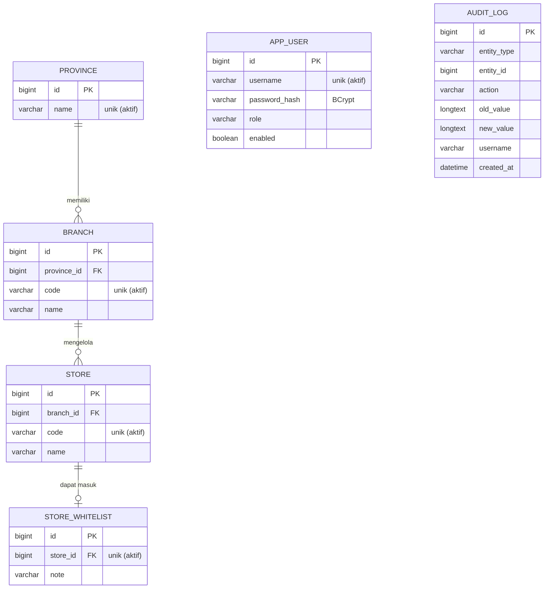

# Rancangan Basis Data

Database: MySQL 8 (InnoDB, `utf8mb4_unicode_ci`). Skema dikelola Flyway (`src/main/resources/db/migration`).

## ERD

Untuk PDF: render blok Mermaid di atas dengan https://mermaid.live atau ekstensi Markdown Preview Mermaid di VS Code, lalu ekspor.

## Hubungan antar tabel

- `province` 1 : N `branch` (FK `branch.province_id`).
- `branch` 1 : N `store` (FK `store.branch_id`).
- `store` 1 : 0..1 `store_whitelist` (FK `store_whitelist.store_id`, unik pada data aktif).
- `audit_log` mencatat perubahan lintas tabel lewat `entity_type` + `entity_id` (tanpa FK agar log tetap ada walau datanya dihapus).
- `app_user` berdiri sendiri; username pelaku perubahan disalin ke kolom `created_by`/`updated_by`/`deleted_by` dan `audit_log.username`.

## Kolom standar tabel master

`created_at`, `created_by`, `updated_at`, `updated_by`, `deleted_at`, `deleted_by`, `version`, `active_key`.

- **Soft delete:** `deleted_at` terisi berarti data terhapus. Aplikasi hanya membaca baris dengan `deleted_at IS NULL`.
- **`active_key`:** kolom generated (`1` bila aktif, `NULL` bila terhapus). Unique key berbentuk `(kolom, active_key)` sehingga keunikan hanya berlaku untuk data aktif dan nilai lama boleh dipakai lagi.
- **`version`:** optimistic locking, mencegah update yang saling menimpa.

## Index

| Tabel | Index | Dipakai untuk |
|---|---|---|
| `province` | `uk_province_name (name, active_key)` | Pencarian nama provinsi (prefix) |
| `branch` | `idx_branch_province (province_id)`, `uk_branch_code` | Join provinsi → cabang, validasi kode |
| `store` | `idx_store_branch (branch_id)`, `uk_store_code` | Join cabang → toko, urut berdasarkan kode |
| `store_whitelist` | `uk_whitelist_store (store_id, active_key)` | Cek toko whitelist, mencegah duplikat |
| `audit_log` | `idx_audit_entity (entity_type, entity_id)`, `idx_audit_created` | Penelusuran per entitas / waktu |

## Integritas audit log

`audit_log` bersifat append-only: trigger `trg_audit_log_no_update` dan `trg_audit_log_no_delete` menolak UPDATE/DELETE langsung di level database.

## Skalabilitas

Kueri pencarian toko melakukan join `store → branch → province` yang dibatasi index dan selalu berhalaman, sehingga biaya per request tidak bergantung pada total jumlah toko. Untuk pertumbuhan jauh lebih besar, opsi lanjutan: keyset pagination dan partisi/replika baca.
